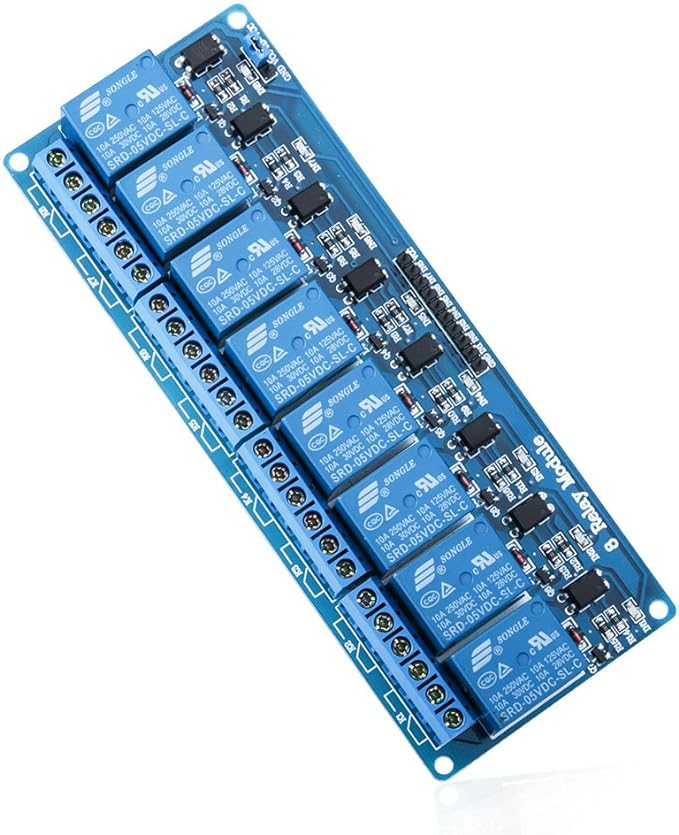
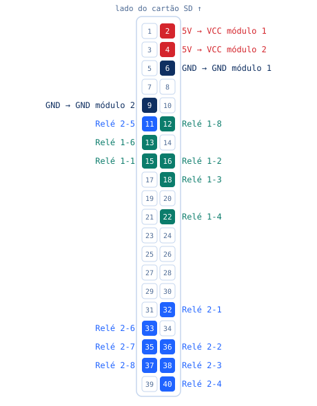
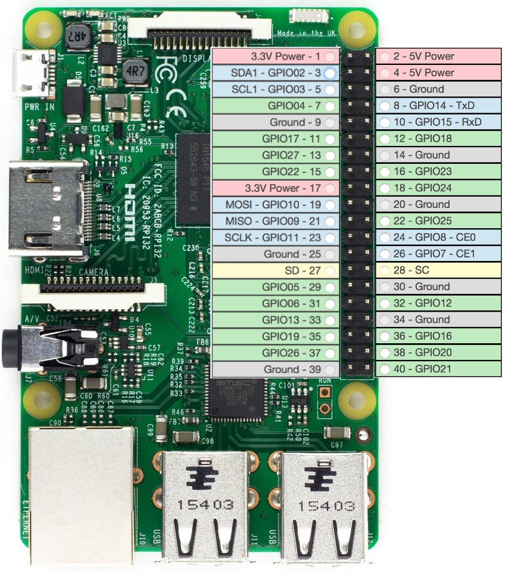

# Preparação do Hardware

Este guia descreve o material necessário e a ligação dos módulos de relés ao Raspberry Pi 4.
Aplica-se a qualquer método de instalação do software PagaLava.

[← Voltar à página principal](../readme.md)

## Material necessário

1. Raspberry Pi 4.
2. Cartão SD com pelo menos 16 GB.
3. Cabo para ligação Ethernet ao Raspberry.
4. 1 módulo de relés de 8 canais DC 5V (2 módulos se tiver mais de 8 máquinas).
5. Cabos jumper fêmea-fêmea para ligar o Raspberry ao(s) módulo(s) de relés.

## Ligação dos relés

Com o Raspberry **desligado da corrente**, ligue cada entrada do módulo de relés ao pino com a mesma cor no mapa abaixo.
Os números são a posição física dos pinos. Só os pinos a cor levam cabo.

| Cor | Ligação |
|-----|---------|
| Azul | Módulo 2, relés 2-1 a 2-8. É o módulo que se liga sempre. |
| Verde | Módulo 1, relés 1-1 a 1-4, 1-6 e 1-8. Opcional, para mais de 8 máquinas. |
| Vermelho | 5 V para o VCC de cada módulo: pino 4 para o módulo 2, pino 2 para o módulo 1. |
| Azul escuro | GND para o GND de cada módulo: pino 9 para o módulo 2, pino 6 para o módulo 1. |

**Até 8 máquinas, um módulo chega.** Ligue só o módulo 2 (10 cabos: 8 de sinal, mais 5 V e GND) e ignore os pinos a verde.
O módulo 1 só é preciso a partir da nona máquina e leva 8 cabos, porque os relés 1-5 e 1-7 não são usados.

**Qualquer relé pode servir qualquer máquina**, de lavar ou de secar. Com dois módulos, uma forma simples de organizar é usar
um para as máquinas de lavar e o outro para as de secar ([exemplo](./rpi2.md)), mas é só uma sugestão. Ligue como for mais
prático na loja e anote que relé ficou em cada máquina: é isso que vai indicar na dashboard ao configurar as máquinas.

## Próximos passos

- Instalar o software: siga as instruções de instalação por cartão SD em [gerir.pagalava.pt](https://gerir.pagalava.pt).
- Depois de instalado, verifique a montagem com o [teste aos módulos de relés](../readme.md#testar-módulos-de-relés).

## Referência: tabela de pinos e GPIO

| Relay Module | Relay Index / Relay Number | GPIO Pin | Physical Pin |
|--------------|----------------------------|----------|--------------|
| Module 1     | 1 - Relay 1-1              | GPIO 22  | 15           |
| Module 1     | 2 - Relay 1-2              | GPIO 23  | 16           |
| Module 1     | 3 - Relay 1-3              | GPIO 24  | 18           |
| Module 1     | 4 - Relay 1-4              | GPIO 25  | 22           |
| Module 1     | 5 - Relay 1-5              | GPIO     |              |
| Module 1     | 6 - Relay 1-6              | GPIO 27  | 13           |
| Module 1     | 7 - Relay 1-7              | GPIO     |              |
| Module 1     | 8 - Relay 1-8              | GPIO 18  | 12           |
| Module 2     | 9 - Relay 2-1              | GPIO 12  | 32           |
| Module 2     | 10 - Relay 2-2             | GPIO 16  | 36           |
| Module 2     | 11 - Relay 2-3             | GPIO 20  | 38           |
| Module 2     | 12 - Relay 2-4             | GPIO 21  | 40           |
| Module 2     | 13 - Relay 2-5             | GPIO 17  | 11           |
| Module 2     | 14 - Relay 2-6             | GPIO 13  | 33           |
| Module 2     | 15 - Relay 2-7             | GPIO 19  | 35           |
| Module 2     | 16 - Relay 2-8             | GPIO 26  | 37           |

| Alimentação | Pino do Raspberry |
|-------------|-------------------|
| Módulo 2 VCC | Pino 4 (5V) |
| Módulo 2 GND | Pino 9 (GND) |
| Módulo 1 VCC | Pino 2 (5V) |
| Módulo 1 GND | Pino 6 (GND) |

Por exemplo, o relé com índice 9, que é o primeiro do segundo módulo de relés, deverá ser ligado ao GPIO 12, que é o pino 32 do Raspberry.

