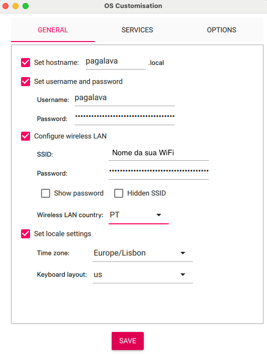
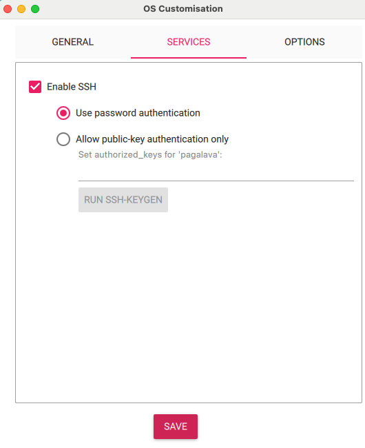

# Instalação Manual (método anterior)

> **Nota:** este é o método de instalação anterior, feito por SSH com os scripts de instalação.
> Continua a funcionar, mas para novas instalações recomendamos a instalação por cartão SD,
> com instruções em [gerir.pagalava.pt](https://gerir.pagalava.pt).

[← Voltar à página principal](../readme.md)

**Versões suportadas:**
- Raspberry Pi OS Bullseye (Debian 11) - `setup_pagalava_iot_debian11.sh`
- Raspberry Pi OS Bookworm (Debian 12) - `setup_pagalava_iot.sh`
- Raspberry Pi OS Trixie (Debian 13) - `setup_pagalava_iot_debian13.sh`

Antes de começar, consulte a [Preparação do Hardware](./hardware.md) para o material necessário e a ligação dos relés.

## 1. Preparação do dispositivo

### 1.1: Instalar o Raspberry Pi Imager

Para começar, precisa do Raspberry Pi Imager para escrever a imagem do sistema operativo no cartão SD. Siga os passos:

1. Faça o download do Raspberry Pi Imager a partir do site oficial: [Raspberry Pi Imager](https://www.raspberrypi.org/software/).
2. Instale o aplicativo no seu computador, seguindo as instruções fornecidas.

### 1.2: Escrever a Imagem do Sistema Operativo

Com o Raspberry Pi Imager instalado, pode gravar a imagem do sistema operativo no cartão SD.

1. Insira o cartão SD no computador.
2. Abra o Raspberry Pi Imager.
3. Em Raspberry Pi Device, escolha o modelo Raspberry Pi 4, ou Pi Zero, dependendo do que está a utilizar.
3. Selecione a opção "Escolher SO" (Choose OS).
4. Selecione a versão do sistema operativo:
   - **Recomendado:** "Raspberry Pi OS (64-bit) Lite" - baseado em Debian Bookworm/Trixie
   - **Legacy:** "Raspberry Pi OS (Legacy, 64-bit) Lite" - baseado em Debian Bullseye
5. Selecione a opção "Escolher Cartão" (Choose Storage) e selecione o cartão SD que você inseriu.
6. Clique em "Escrever" (Write) para começar a escrever a imagem no cartão SD.

### 1.3: Configuração geral 

Nome de utilizador: pagalava (recomendado).
Password: À sua escolha, uma password segura.

Para sistemas em loja, apenas a ligação por Ethernet é suportada.
Pode usar WiFi para a configuração apenas por comodidade.
Para instruções detalhadas sobre configuração WiFi, consulte o [Guia de Configuração WiFi](./configuracao_wifi.md).
Seleccione o país e teclado.



### 1.4: Serviço SSH

Ative o serviço SSH. Pode usar password para autenticação ou uma chave SSH (recomendado).



## 2. Configuração do sistema PagaLava
Localize o Raspberry na sua rede, identificando o endereço IP, e ligue-se ao Raspberry por SSH.

Não é necessário atualizar o sistema operativo, os updates serão executados no script de instalação.

### Debian 12 (Bookworm) - Recomendado
Para instalar em Raspberry Pi OS Bookworm, execute:

```bash
curl -sSL -o setup_pagalava_iot.sh https://raw.githubusercontent.com/airesmarques/pagalava-iot/main/setup_pagalava_iot.sh
chmod +x setup_pagalava_iot.sh
. ./setup_pagalava_iot.sh
rm setup_pagalava_iot.sh
```

### Debian 13 (Trixie)
Para instalar em Raspberry Pi OS Trixie, execute:

```bash
curl -sSL -o setup_pagalava_iot.sh https://raw.githubusercontent.com/airesmarques/pagalava-iot/main/setup_pagalava_iot_debian13.sh
chmod +x setup_pagalava_iot.sh
. ./setup_pagalava_iot.sh
rm setup_pagalava_iot.sh
```

### Debian 11 (Bullseye) - Legacy
Para instalações em Raspberry Pi OS Bullseye (legacy), execute:

```bash
curl -sSL -o setup_pagalava_iot.sh https://raw.githubusercontent.com/airesmarques/pagalava-iot/main/setup_pagalava_iot_debian11.sh
chmod +x setup_pagalava_iot.sh
. ./setup_pagalava_iot.sh
rm setup_pagalava_iot.sh
```

## Próximos passos

Com o software instalado, continue na página principal:

- [Testar módulos de relés](../readme.md#testar-módulos-de-relés)
- [Executar diagnósticos do dispositivo](../readme.md#executar-diagnósticos-do-dispositivo)
- [Ligação manual à Cloud Pagalava](../readme.md#ligação-manual-à-cloud-pagalava)
